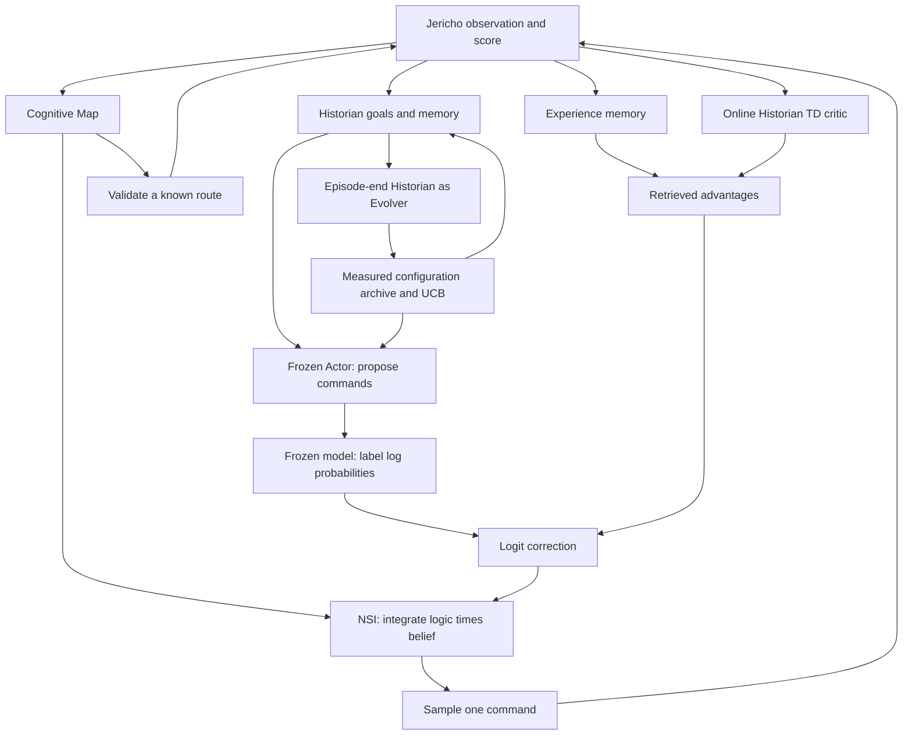

# Evolving Actor-Historian neuro-symbolic agent

This branch combines three ideas while keeping their learning signals separate.
It is a new hybrid implementation, not a reproduction of EvoTest or JitRL.



## Fast loop: model logits and actor-critic feedback

The Actor produces a command shortlist and a compact state report. A second
request maps up to five commands to exact single tokens `A` through `E` and
requests their actual model log probabilities. These log probabilities are
logits up to a shared additive constant. This is a **finite labelled-choice
policy**, not the probability of generating each complete command string.
The model's internal token tensors are not edited on the remote server.

Every candidate token must appear in the response at the same first token
position. Whitespace variants, omitted top-k entries, sentinel values and
unsupported endpoints are rejected. Missing probabilities are never inferred
from rank or from model-written confidence numbers. An explicit `rank` mode
provides an alternative weak prior for ablation and logs that distinction.
The API permits up to 20 returned token alternatives, but may return fewer;
support must be tested against the actual compatible endpoint.
[API response contract](https://developers.openai.com/api/reference/python/resources/chat/subresources/completions/methods/create)

The policy uses:

```text
TD target = r + gamma * V(next_state)       # zero bootstrap on terminal states
delta = TD target - V(state)
V weights += learning_rate * delta * features / squared_feature_norm

Q_MC(state, action) = similarity-weighted completed returns for that action
A_MC = Q_MC - similarity-weighted state return
A_TD = similarity-weighted action-conditioned TD residuals
A = mean(A_MC, A_TD) when both exist; otherwise use available evidence
z_adapted(a) = z_model(a) + beta * clipped_scaled(A(a)) + exploration_bonus(a)
```

Counts shrink uncertain advantages, scale is at least one, and clipping limits
absolute correction. This is an explicitly biased small-data estimator. The
critic is external sparse linear TD(0), not a second fine-tuned LLM. **All Actor,
Historian LLM and optional embedding-model weights are frozen. The external
critic's coefficients do learn.** Thus this hybrid is not wholly gradient-free
in the same sense as JitRL's nonparametric critic. The unmodified JitRL
closed-form identity holds for a given advantage; its convergence results do
not automatically transfer to this clipped mixture, partial state abstraction,
evolving prompts, or symbolic conditioning.

The same reward definition feeds both learners: score delta by default, plus
optional environment-reward weighting and no-progress penalty. A score delta
is not added twice. All commands, including deterministic navigation, train
the critic and contribute to delayed returns. Only Actor-selected commands
enter Actor policy experience. Terminal transitions suppress bootstrap;
time-limit truncations may bootstrap from the external critic. Failed episodes
are labelled in experience and excluded from configuration fitness/metrics.

The numerical policy samples its posterior by default. `--no-sample-actions`
uses greedy selection and records its deterministic behavior probability
separately from the posterior distribution. A local seed controls this sampling
and Jericho's reset seed. It does not guarantee reproducibility of remote LLM
generation.

## Slow loop: evolve the actual prompt structure

`evolution.py` stores bounded, versioned configurations with content hashes,
parent IDs, measured episode scores and visit counts. UCB selects one complete
configuration for an episode. A Historian/Evolver request proposes a child
from the parent and a bounded, explicitly marked episode transcript. Invalid
mutations leave the archive unchanged; a proposed child has no measured reward
until it actually runs. Measured parents remain candidates, subject to a bounded
archive that preserves the original and active parent.

Mutable fields include Actor strategy text, Historian review strategy, ordering
of eight required Actor prompt sections, temperature, history length, retrieval
size/threshold, memory guidance, logit strength, exploration, critic step size,
and route risk weight. This changes both prompt content and structure. Memory
is updated from the actual trajectory rather than invented by a mutation.
Tool behavior changes through these declarative settings; generated Python is
not executed. Output schemas and environment command validation stay fixed.

The Historian's strategic goal selector remains deterministic. It learns from
score evidence and inventory reports, but this implementation does not learn
a separate stochastic policy over Historian goals. Its adaptive roles are the
TD critic, episode lessons and the configuration Evolver. This distinction
matters when describing the system as actor-critic.

## NSI and the Cognitive Map

For finite Boolean interpretations and counting measure:

```text
F(phi) = sum_world logic(phi, world) * belief(world)
belief(world) = product_atom p(atom)^truth * (1-p(atom))^(1-truth)
```

`NeuroSymbolicInference.integrate()` computes exact weighted model counting
for up to 16 atoms; it supports Boolean indicators or bounded fuzzy truth
values. `conjunction()` analytically integrates a conjunction and deduplicates
shared atoms, supporting long routes without enumerating 2^n worlds.
Contradictory literals have zero mass. The enumeration budget fails explicitly.

At action selection, the categorical neural belief is the adapted policy and
the symbolic formula constrains available commands and observed traversability:

```text
mass(a) = softmax(z_adapted)[a] * P(map constraints for a)
pi_NSI(a) = mass(a) / sum_b mass(b)
```

This is an integral over a product of logic and belief, followed by conditioning.
Zero feasibility masks a command. If the entire shortlist is inconsistent, the
Actor is queried once on the remaining feasible commands; inconsistent actions
are not reinstated as a fallback. Unknown actions retain support for exploration.
The log satisfaction mass and policy KL are computed stably even for small
probabilities.

The map is the existing directed room graph with Beta(1,1) traversal counts.
An imported historical edge supplies one observed success. Current-episode
confirmed edges have belief one and blocked edges zero. A verified change in
the local world-object hash invalidates local confirmation/blockage evidence;
it does not erase history. Room identity, actual movement and score feedback
are authoritative; Actor inventory and clues remain hypotheses.

Navigation minimizes `command_count - risk_weight * log(route_success)` under
independent edge assumptions, then validates each command. Macro edges are
treated as atomic observed transitions. For commands with several historical
destinations, action feasibility uses maximum supported edge belief, a heuristic
for alternative destination hypotheses. These beliefs are not calibrated
physical probabilities. Correlated door conditions and long-horizon puzzle
preconditions require a richer symbolic model; no such rules are fabricated.

## Memory and persistence

The default retrieval representation is transparent lexical/state similarity.
`--memory-embedding-model MODEL_OR_PATH` adds a frozen SentenceTransformer and
mixes cosine similarity equally with the existing state similarity. Its cache
is bounded and shared by Actor retrieval and the TD critic. A lexical prefilter
limits neural reranking to at most 512 records per query; this is approximate
retrieval, not an exact global nearest-neighbor search. Without that option,
the memory index must not be described as a learned neural embedding index.

Existing `WorldMap` files load with either NetworkX `links` or `edges` fields.
Actor JSONL version 1 records remain readable; new version 2 records include
terminal/truncation flags and policy probabilities. Critic schema 1 coefficients
can load into schema 2; unknown/corrupt schemas fail without silently overwriting
the source. New experiments use `historian_td.json`, separate from the former
Monte-Carlo critic file. Map, critic and configuration writes use replacement
of a temporary file. The original Historian JSON and per-episode text logs are
retained. Use `--fresh-memory` for independent experimental sessions.

## Evaluation boundaries

The runner uses privileged Jericho room IDs, valid-action generation and
world-change hashes. Valid-action generation can test simulator commands
internally. Existing goal logic contains Zork-specific return/deposit heuristics.
It loads no walkthrough, but these features make its setting different from a
text-only agent and should be disclosed in comparisons. Local probabilities,
TD errors, configuration IDs, prompts, actions, rewards and final scores are
logged. API request counts exclude the subsequent evolution call and are named
accordingly; dollar cost and complete token accounting are not yet estimated.

Do not claim SOTA from unit tests, a single peak score, or a longer interaction
budget. Run matched-budget, matched-backbone, matched-information comparisons
with independent memories and multiple seeds. See `research.md` for the paper
protocols and framework assessment.
